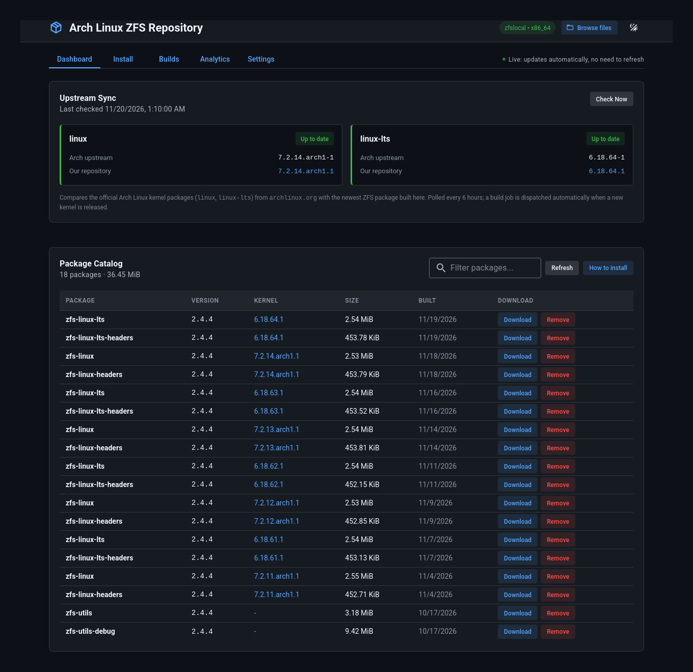
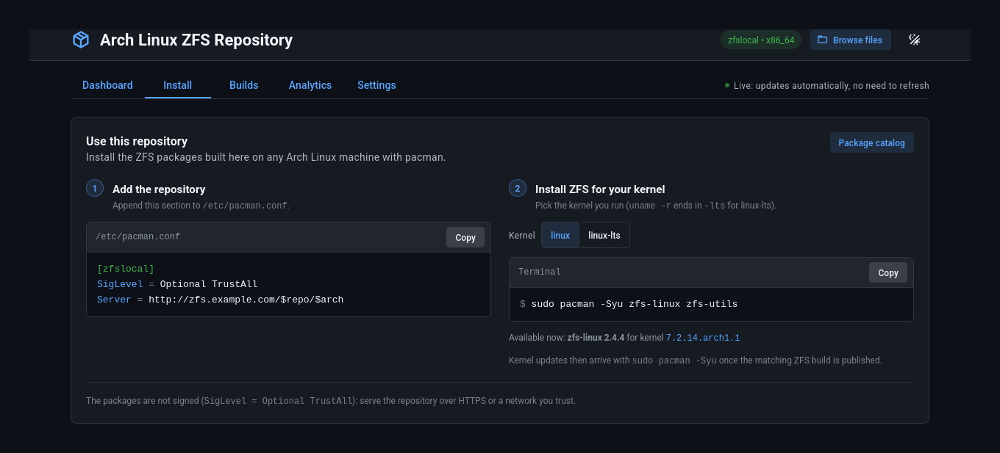
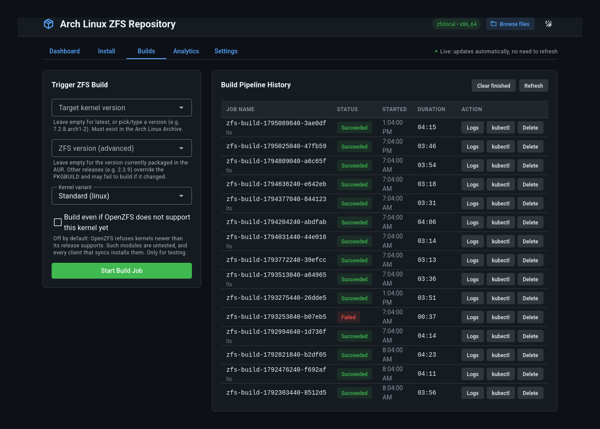
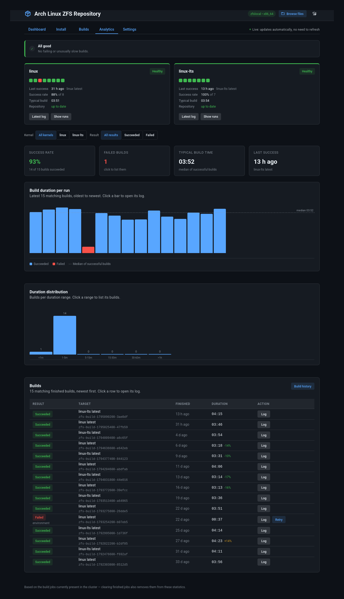

# arch-zfs-docker

Builds `zfs-linux` and `zfs-utils` packages for the Arch Linux kernels (`linux`, `linux-lts`) as soon as Arch Linux
publishes a new kernel, and serves them as a pacman repository. It runs in Kubernetes, or on one machine with Docker,
and has a web UI for the kernels, the builds and their logs.

**Documentation: https://markusressel.github.io/arch-zfs-docker/**



<details>
<summary>More screenshots</summary>

**Install:** pacman setup with copyable snippets for the chosen kernel.



**Builds:** build any kernel and OpenZFS version, follow running jobs and open their logs.



**Analytics:** what needs attention, health per kernel, build durations and a filterable list of builds.



</details>

## Quick start

Deploy the server in Kubernetes with the manifests in [`deploy/k8s/`](deploy/k8s/), see
[Deploy in Kubernetes](https://markusressel.github.io/arch-zfs-docker/getting-started/kubernetes/). Then add the
repository on each client:

```ini
[zfslocal]
SigLevel = Optional TrustAll
Server = https://zfs.example.com/$repo/$arch
```

```bash
sudo pacman -Syu zfs-linux zfs-utils
```

When the repository has no package for the newest kernel yet, a full upgrade fails on the kernel dependency of
`zfs-linux`. [Updating while ZFS is held back](https://markusressel.github.io/arch-zfs-docker/guides/held-back-updates/)
has the command for that case.

## Development

```bash
just install-ui && just build-ui   # once: the server embeds the web UI
just dev                           # server with builds in local Docker, UI with hot reload on :5173
go test ./... && just test-ui
just docs-serve                    # this documentation on http://localhost:8001
```

See [Development](https://markusressel.github.io/arch-zfs-docker/development/).
