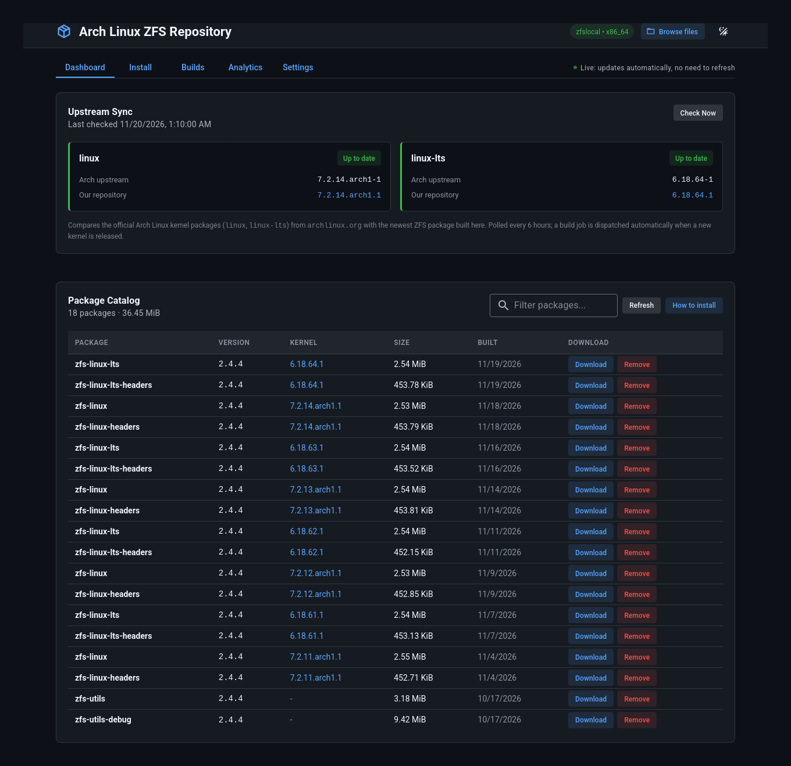

# arch-zfs-docker

arch-zfs-docker builds `zfs-linux` and `zfs-utils` packages for the Arch Linux kernels and serves them as a pacman
repository. It runs in a Kubernetes cluster, or on a single machine with Docker. A web UI shows which kernels have
packages, which builds ran and why one failed.

## Why

`zfs-linux` is a kernel module, built for one exact kernel version. The package depends on that version
(`linux=7.2.14.arch1-1`), so pacman cannot update the kernel until a `zfs-linux` for the new kernel exists. The AUR
package has to be rebuilt by hand after every kernel update, and `zfs-dkms` builds the module on every machine
during the upgrade. When that build fails, the new kernel is installed without a ZFS module.

This project builds the module once, on a server, as soon as Arch Linux publishes a new kernel. The machines that
use the repository get the kernel and the matching module in the same `pacman -Syu`. When the module cannot be built,
the machines keep the kernel they have and update everything else.

## How it works

1. The server asks `archlinux.org` every 6 hours for the newest `linux` and `linux-lts` packages.
2. When the repository has no `zfs-linux` for a new kernel, the server starts a build: a Kubernetes Job, or a Docker
   container. The build installs the kernel and its headers in an `archlinux:base-devel` container, builds `zfs-utils`
   and `zfs-linux` from the AUR with `makepkg` and adds them to the pacman database.
3. Clients list the repository in `/etc/pacman.conf` and install `zfs-linux` and `zfs-utils` from it.

OpenZFS supports each Linux version only after a release declares it (`Linux-Maximum` in its `META` file). The server
reads that, warns before a build that will probably fail, and pauses automatic builds for a kernel that OpenZFS
refused. See [New kernels and OpenZFS support](guides/new-kernels.md).

## The web UI

| Page | Shows |
|---|---|
| Dashboard | Each kernel of Arch Linux next to the newest kernel with packages here, OpenZFS support, the last failed build with its cause, and the package catalog. |
| Install | The `pacman.conf` section and the install command for the chosen kernel. |
| Builds | A form to build any kernel and OpenZFS version, and the build jobs with their logs. |
| Analytics | Failing kernels, success rates, build durations and a filterable list of builds. |
| Settings | The check interval, the build node and display settings. |

## Where to go next

- [Deploy in Kubernetes](getting-started/kubernetes.md) or [run it with Docker](getting-started/docker.md).
- [Set up a client](getting-started/clients.md).
- [Update a machine while ZFS is held back](guides/held-back-updates.md).
